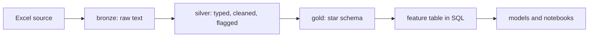

# Customer Churn Platform

End-to-end customer churn prediction on a real retail dataset: a PostgreSQL warehouse, SQL analytics, Jupyter analysis, leakage-safe features, walk-forward model evaluation and customer value forecasting.

> **Status:** in progress. Parts 0 to 7 are done and Part 8 (interpretation and business impact) is under way. See the roadmap below.

## The question

Which customers are about to stop buying, and which ones should a retention team contact first?

## Data

[UCI Online Retail II](https://archive.ics.uci.edu/dataset/502/online+retail+ii): 1,067,371 invoice lines from a UK online gift retailer, December 2009 to December 2011.

The retailer has no subscriptions, so churn means inactivity. A customer is active if they bought in the last 180 days, and churned if they make no purchase in the following 90 days. The definition and its limits are in [docs/churn_definition.md](docs/churn_definition.md).

## Architecture



Design decisions are in [docs/warehouse_design.md](docs/warehouse_design.md).

## What is built

- **Warehouse (PostgreSQL):** bronze, silver and gold layers with a star schema, all defined in `sql/`. Duplicate rows and non-product lines are flagged, not deleted.
- **Data quality:** 25 SQL checks across the three layers, run by a small Python runner. Revenue in gold reconciles exactly to silver.
- **Analytics in SQL:** cohort retention and RFM segment views.
- **Features:** 47,933 rows (one per active customer per monthly snapshot, 16 snapshots). Every feature uses only data before the snapshot, and tests recount features and labels independently to catch leakage.
- **Modeling:** walk-forward evaluation, where each month is scored by a model trained only on snapshots whose outcome was already known.
- **Survival and customer value:** Kaplan-Meier curves and a BG/NBD + Gamma-Gamma value model.
- **Notebooks:** data overview, churn definition sensitivity, cohorts and hypothesis test, modeling, survival and value, SHAP interpretation.

## Results

Mean over 10 test snapshots (Dec 2010 to Sep 2011). About 53% of test customers churned.

| Model | ROC-AUC | Precision in top 10% |
|-------|---------|----------------------|
| Recency baseline | 0.674 | 0.755 |
| Logistic regression | 0.779 | 0.835 |
| XGBoost | 0.767 | 0.813 |

- Logistic regression was the best model. With 16 features the signal is mostly linear.
- Ranking works: the highest-risk decile churned at 81%, the lowest at 10%.
- Raw probabilities are not reliable. Calibration depends on the season, so the model is used for ranking, not as an absolute churn rate.
- The purchase forecast was within 1% of actual (7,731 predicted against 7,753) on a six-month holdout that includes the Oct-Nov peak.

More detail: [docs/modeling_notes.md](docs/modeling_notes.md) and [docs/data_notes.md](docs/data_notes.md).

## Repository layout

- `sql/schemas`, `sql/transformations`, `sql/marts`, `sql/features`: warehouse, views and feature table
- `sql/quality`: data quality and leakage checks
- `src/`: ingestion, quality runner, database helper and models
- `notebooks/`: analysis notebooks
- `docs/`: problem statement, churn definition, design and findings

## Run it yourself

```powershell
py -m venv .venv
.venv\Scripts\Activate.ps1
pip install -r requirements.txt
copy .env.example .env
```

Edit `.env` with your PostgreSQL settings, download the dataset and build the warehouse by following [data/README.md](data/README.md).

## Roadmap

| Part | Topic | Status |
|------|-------|--------|
| 0 to 7 | Setup, scoping, warehouse, ingestion, SQL analytics, EDA, features, modeling | Done |
| 8 | Interpretation and business impact | In progress |
| 9 | Streamlit dashboard | Planned |
| 10 | API and Docker | Planned |
| 11 | Tests, CI and experiment tracking | Planned |
| 12 | Final polish | Planned |

## Limitations

One retailer, about two years of data, and no marketing or support data. The training window contains no December, so the early test months are the hardest. Value estimates cover only customers with at least one repeat purchase.

## License

MIT
