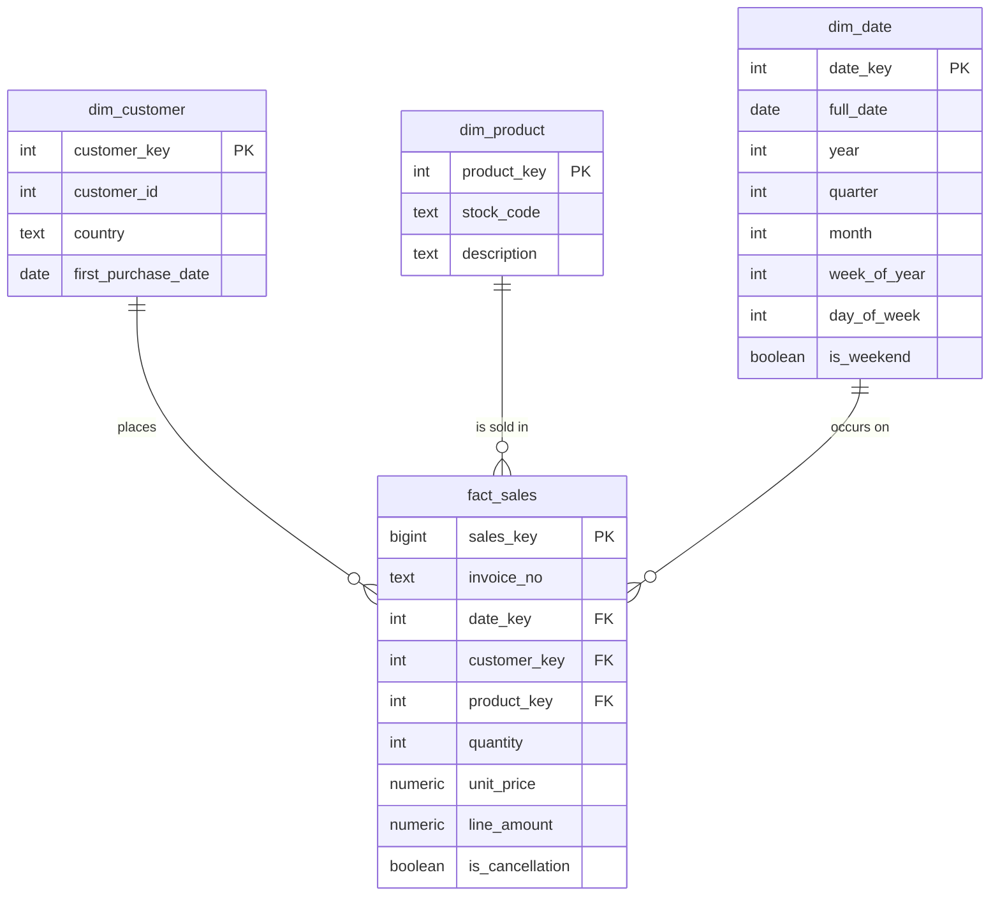

# Warehouse Design

## Layers

| Layer | Purpose | Rule |
|-------|---------|------|
| bronze | Raw copy of the source | All columns are text. Nothing is fixed or dropped. |
| silver | Clean, typed transactions | One row per invoice line. Problems are flagged, not hidden. |
| gold | Star schema for analytics and modeling | Built only from silver. Rows without a customer are excluded. |

## Star schema

**Grain of the fact table:** one row per invoice line.

## Design decisions

| Decision | Reason |
|----------|--------|
| Bronze columns are all TEXT | The raw load can never fail on a bad value. Cleaning happens in silver, where it is visible and testable. |
| Cancellations are kept, with a flag | They carry information about customer behavior and are used as a feature later. |
| Non-product lines (postage, fees) are flagged, not deleted | Revenue totals can include or exclude them on purpose. |
| Rows without a Customer ID stay in silver but not in gold | The churn model needs a customer to score. Revenue reports can still use silver. |
| Surrogate keys in gold | Keeps the fact table small and stable if source IDs change. |
| Indexes on customer and date | Churn features are computed per customer over time windows. |

## Files

SQL definitions are in `sql/schemas/`, numbered in the order they run.
